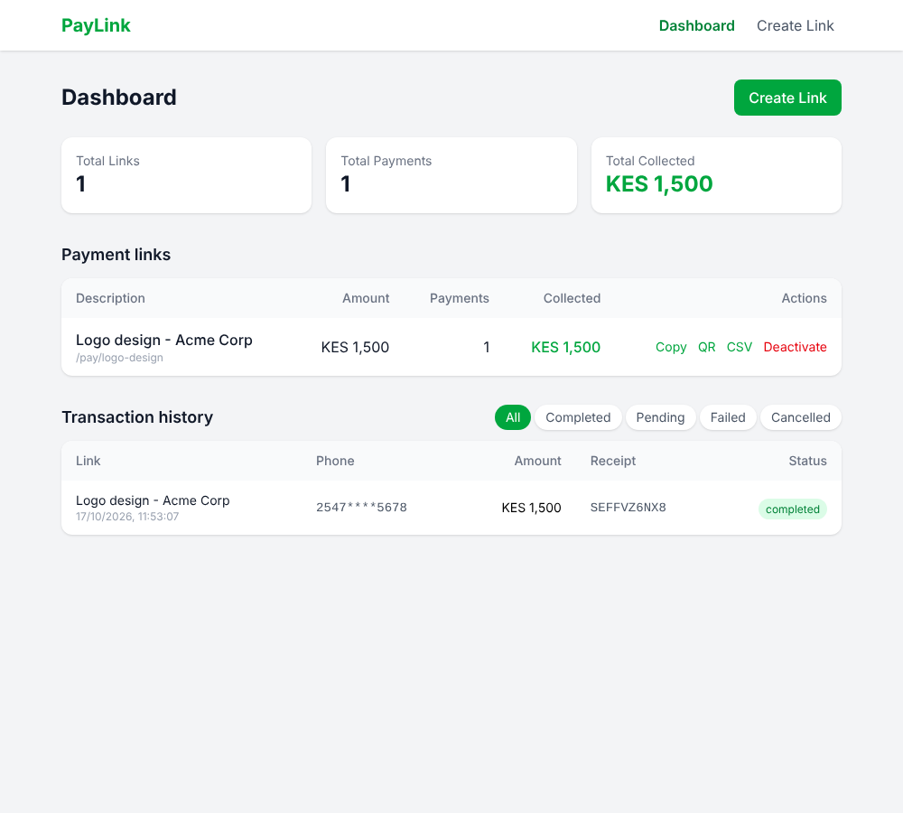

# PayLink v1

Create an M-Pesa payment link (`/pay/logo-design`), send it to a client, and let them pay by STK Push.
You get a dashboard with every link, how many payments it received and how much it collected.

## Tech stack

- **Backend:** Node.js, Express 5, Prisma 6, PostgreSQL (local Postgres or Supabase), axios, Nodemailer, qrcode
- **Frontend:** React 19 (Vite), React Router, Tailwind CSS v4
- **Payments:** Safaricom Daraja API (sandbox) - OAuth, STK Push, callback, STK Query



## Features

Required
- Create payment links (amount, description, optional custom slug) -> shareable URL
- Payment page with amount/description pre-filled, STK Push, polling, success / failed / cancelled / timeout states
- Dashboard with link list, payment counts, totals collected, recent payments
- Prisma models `PaymentLink` and `Payment`, callback handling with idempotency, friendly error handling

Bonus (all five)
1. **Custom slugs with validation** - lowercase letters/numbers/dashes, 3-50 chars, reserved words blocked, live URL preview as you type
2. **Payment confirmation email** - Nodemailer (Gmail app password); optional "notify me" email per link
3. **QR code** - `GET /api/links/:slug/qr`, shown after creation and from the dashboard (downloadable)
4. **Link deactivation** - Deactivate / Activate on the dashboard; inactive links show "This payment link is no longer active."
5. **CSV export** - `GET /api/links/:slug/payments.csv`, "CSV" button on the dashboard

## Setup

```bash
# 1. Database (PostgreSQL) and server
cd server
cp .env.example .env        # then fill in DATABASE_URL + Daraja keys
npm install                 # also runs prisma generate
npx prisma migrate dev --name add-payment-links
npm run dev                 # http://localhost:3000

# 2. Client (new terminal)
cd client
npm install
npm run dev                 # http://localhost:5173  (proxies /api -> :3000)

# 3. Tunnel for callbacks (new terminal)
ngrok http 5173
# put https://<id>.ngrok-free.app/api/mpesa/callback in MPESA_CALLBACK_URL and restart the server
```

### Environment variables (`server/.env`)

| Variable | Purpose |
| --- | --- |
| `DATABASE_URL` | PostgreSQL connection string |
| `MPESA_CONSUMER_KEY` / `MPESA_CONSUMER_SECRET` | Daraja app credentials |
| `MPESA_SHORTCODE` / `MPESA_PASSKEY` | Sandbox: `174379` and the Daraja test passkey |
| `MPESA_CALLBACK_URL` | Public ngrok URL ending in `/api/mpesa/callback` |
| `MPESA_CALLBACK_SECRET` | Optional shared secret added as `?token=` to the callback URL |
| `APP_URL` | Base URL of the React app (used in QR codes and emails) |
| `MPESA_MOCK` | `true` = fake STK push that auto-completes after ~5s |
| `EMAIL_USER` / `EMAIL_APP_PASSWORD` | Optional Gmail + app password for notification emails |

## API

| Method | Path | Notes |
| --- | --- | --- |
| POST | `/api/links` | `{ amount, description, slug?, creatorEmail? }` -> 201 |
| GET | `/api/links` | all links with `totalPayments`, `totalCollected`, `totalAttempts` |
| GET | `/api/links/:slug` | 404 unknown, 410 inactive |
| PATCH | `/api/links/:slug` | `{ active: boolean }` |
| GET | `/api/links/:slug/qr` | `{ qr: dataUrl, url }` |
| GET | `/api/links/:slug/payments.csv` | CSV download (phone numbers masked) |
| POST | `/api/mpesa/stkpush` | `{ phoneNumber, linkSlug }` (or `{ phoneNumber, amount }` without a link) |
| POST | `/api/mpesa/callback` | Daraja callback, always answers 200 |
| POST | `/api/mpesa/simulate-callback` | dev/mock only: `{ paymentId, success }` |
| GET | `/api/payments/:id/poll` | status + receipt |
| GET | `/api/payments` | list, optional `status`, `linkSlug`, `limit` |
| GET | `/api/health` | |

`GET /api/payments` supports `?status=completed|pending|failed|cancelled`. Statuses: `pending`, `completed` (ResultCode 0), `cancelled` (1032), `failed` (anything else).

## Testing

```bash
cd server && npm test
```
26 tests: phone/slug/CSV/timestamp helpers and the whole API (validation, full payment flow, duplicate callbacks,
cancel/fail, deactivation, QR, CSV, rate limiting, STK Query fallback).
These run against an in-memory stand-in for Prisma (`server/test/fakePrisma.js`), so they need no database.

## Spec checklist

| Requirement | Where |
| --- | --- |
| Create link, random 8-char slug, slug validation + uniqueness, Copy Link | `/create`, `POST /api/links` |
| Payment page: read-only amount, description, "Pay Now", 404 / deactivated errors | `/pay/:slug` |
| OAuth token caching, STK Push, callback, idempotency, STK Query fallback | `server/lib/mpesa.js`, `server/app.js` |
| Polling every 3s, max 40, cleanup on unmount | `client/src/components/PaymentForm.jsx` |
| Dashboard: summary cards, link list with Copy, empty state | `/dashboard` |
| Transaction history: masked phone, badges, receipt, newest first, All/Completed/Pending/Failed filter | `/dashboard` |
| Stretch: QR code (+10), confirmation email (+10), deactivation + CSV (+10) | all implemented |

## Screen recording
<video src="https://github.com/user-attachments/assets/70b014e6-ee3d-44f7-be0a-3bb678f384c7" width="100%" autoplay loop muted playsinline>
</video>
